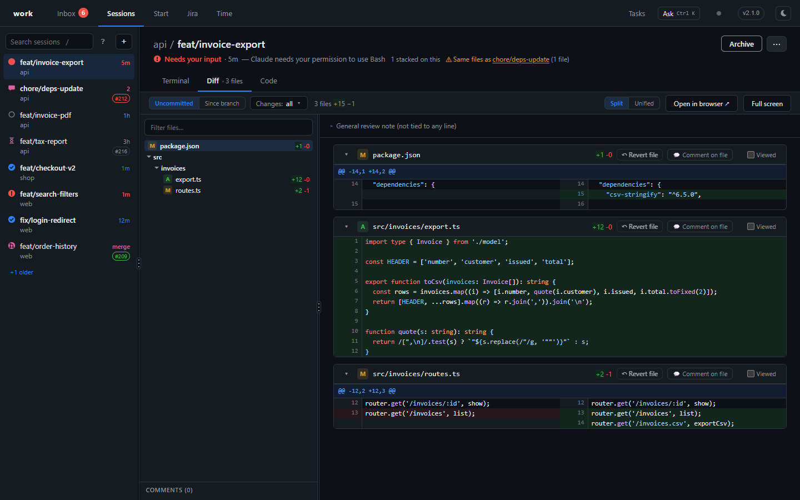
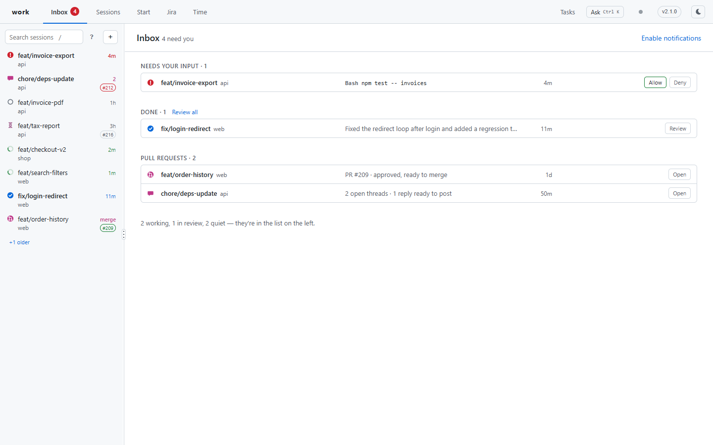
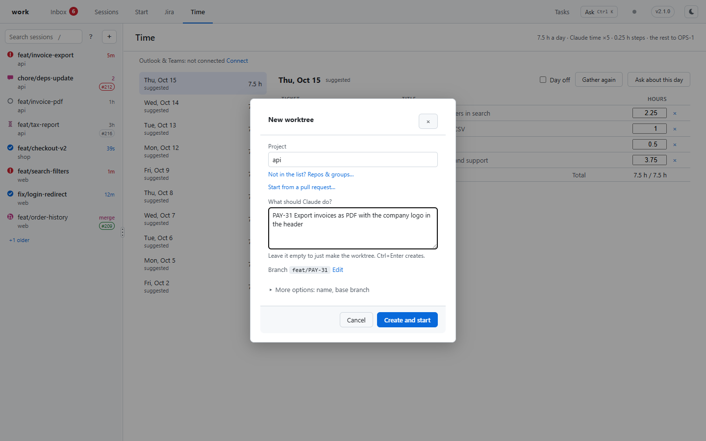
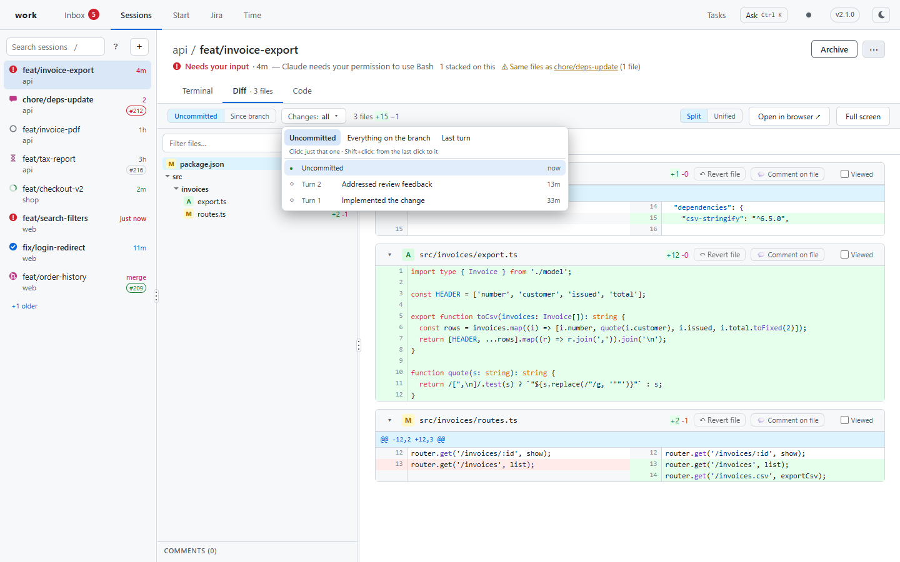
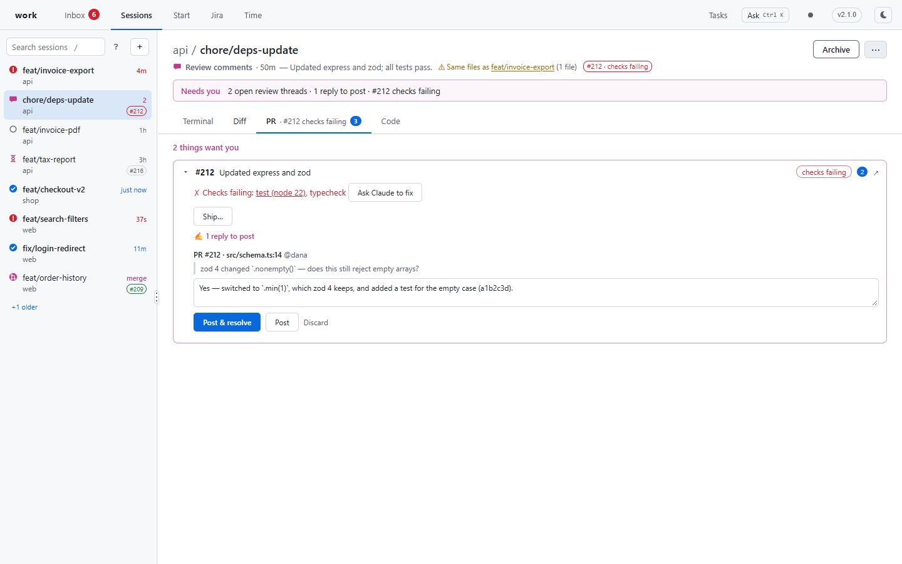
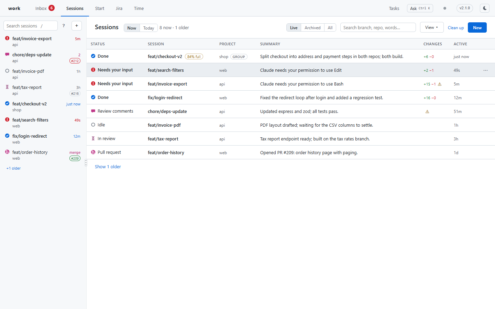
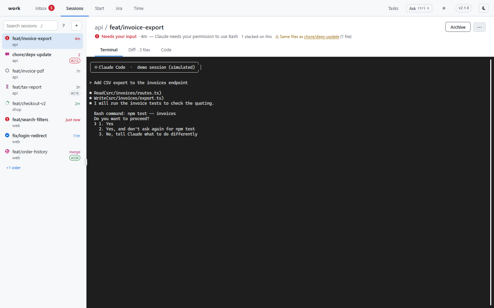
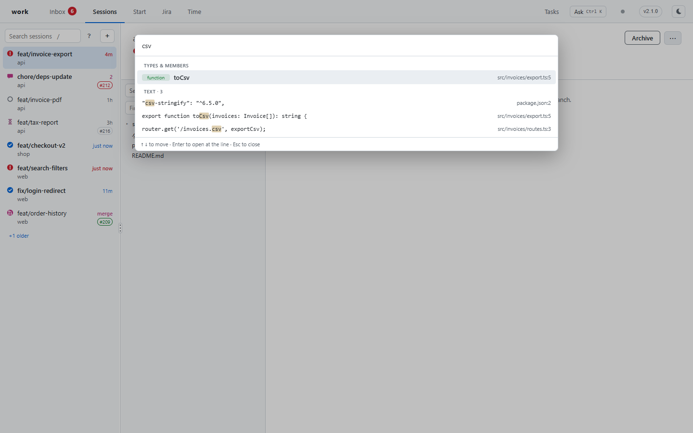
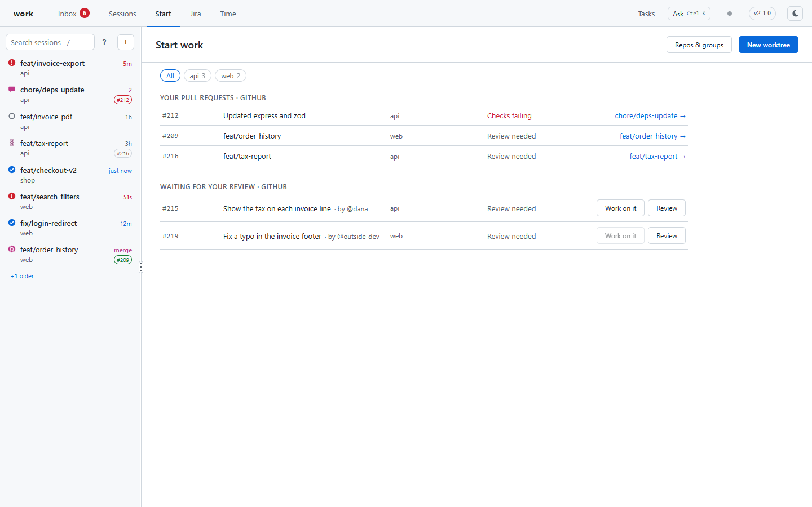
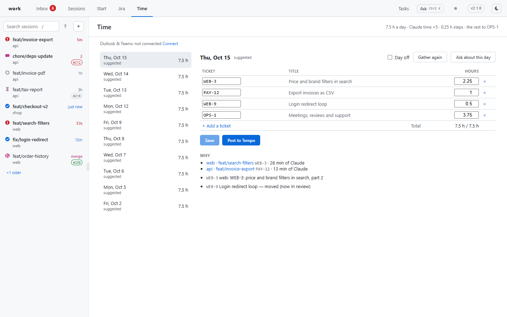

<div align="center">

# work

### Run ten Claude Code sessions at once, and always know which one needs you.

**work is a desktop app (and a browser dashboard) for working with AI coding agents on many branches at the same time. Every task gets its own git worktree and its own Claude Code session. One window shows all of them: who is waiting for your answer, what each one changed, where its pull request stands, and the terminal it runs in.**

[](https://www.npmjs.com/package/@moberg_hr/work-tree)
[](https://github.com/moberghr/cli-work-tree-manager/releases/latest)
[](https://moberghr.github.io/cli-work-tree-manager/)
[](https://nodejs.org/)
[](LICENSE)

[Install](#install) · [A day with work](#a-day-with-work) · [Every feature](#every-feature-and-what-it-does-for-you) · [Keyboard](#keyboard) · [The CLI](#the-cli) · [Configuration](#configuration) · [FAQ](#faq)



</div>

---

## Why work

An AI agent makes one branch go fast. Several agents on several branches should make you several times faster, but in practice you end up with a terminal per agent, no idea which one finished or is stuck on a permission prompt, diffs you never looked at, and worktrees nobody cleans up.

work takes care of all of that:

- **One task, one worktree, one agent.** "New worktree" makes the branch, the checkout and the Claude session in one step, and starts Claude on what you asked.
- **One window for all of them.** The Inbox shows the sessions that want you: waiting on a permission prompt, finished and not looked at, a pull request ready to merge or failing.
- **Review what the agent did, turn by turn.** Every Claude turn is recorded, so you see exactly what the last instruction changed, or everything since you last looked.
- **Pull requests handled where you work.** Failing checks and review comments are handed to the session's Claude; replies go to GitHub only when you say so.
- **Nothing lost, nothing left behind.** Sessions survive restarts and reboots. Merged work archives itself and can be restored exactly as it was, and Clean up removes what's no longer needed.

Claude Code is the default agent. work also starts any other CLI agent, with fewer features (see [FAQ](#faq)).

---

## Install

**The desktop app** (recommended): the dashboard in its own window, with the `work` and `wd` commands included. It updates itself.

| Platform | Download |
|:---|:---|
| Windows | [WorkDesktop-win-Setup.exe](https://github.com/moberghr/cli-work-tree-manager/releases/latest/download/WorkDesktop-win-Setup.exe) |
| macOS (Apple silicon) | [WorkDesktop-osx-Setup.pkg](https://github.com/moberghr/cli-work-tree-manager/releases/latest/download/WorkDesktop-osx-Setup.pkg), or `brew install --cask moberghr/work-tree/work-desktop` |
| Linux | [WorkDesktop.AppImage](https://github.com/moberghr/cli-work-tree-manager/releases/latest/download/WorkDesktop.AppImage) |

**Or just the command line**, with the same dashboard in your browser (`work web`):

```bash
npm install -g @moberg_hr/work-tree        # or: brew install moberghr/work-tree/work
work web                                    # opens the dashboard
```

On first start, the app's **Welcome** page asks where your repos are and where worktrees should go, lists the repos it finds so you can tick them, and checks your tools:

| Tool | | What for |
|:---|:---|:---|
| Git | needed | Worktrees |
| [Claude Code](https://claude.ai/code) | needed | The agent in each session |
| [GitHub CLI](https://cli.github.com/) (`gh`) | optional | Pull requests: their status, checks, review comments, Ship |
| [Atlassian CLI](https://developer.atlassian.com/cloud/acli/) (`acli`) | optional | Jira: your issues, starting work on one, the Time tab |

Want to look around first? `work web --demo` opens the real app on a made-up world (repos, agents, PRs, Jira) and touches nothing of yours.

---

## A day with work



**Morning.** The Inbox lists what needs you: a session blocked on `npm test` (Allow / Deny right there), one that finished overnight, a PR that's approved and green. **Sessions → Today** gives you a standup note of what every session did yesterday.

**Starting something.** Press `c`, pick the project and write what Claude should do: `PAY-31 Export invoices as PDF`. work names the branch (`feat/PAY-31`), creates the worktree, copies your local settings into it and starts Claude with your prompt. Or start from a Jira issue, from one of your pull requests, or from a PR someone asked you to review.



**While they work.** Each session has a **Terminal** (Claude itself, live), a **Diff**, a **PR** tab and a **Code** tab. When a session wants you, the Inbox count and the taskbar badge go up, and you get a notification unless you're already looking at it. `n` jumps to the next session that wants you.

**Reviewing.** The Diff opens on what changed since you last looked. Leave comments on lines, and Claude gets them on its next turn. Look at one turn, one commit, or any span of them.



**Pull requests.** **Ship…** pushes, opens the PR and merges it when it's ready. When checks fail or a reviewer comments, the session's Claude is told, plans a fix and drafts replies for you to post. When the PR gets a merge conflict, its Claude merges the base branch in and resolves it, and asks you when a conflict takes a decision.



**Done.** When the PR merges, the session archives itself: Claude stopped, worktree removed, the conversation and any uncommitted files kept. Restore brings it back exactly as it was.

---

## Every feature, and what it does for you

### Knowing who needs you

| Feature | What it does for you |
|:---|:---|
| **Inbox** | One list of the sessions that want you, most urgent first: *needs your input* (a permission prompt or a question), *done* (finished, not looked at), *pull requests* (ready to merge, conflict, failing checks), *review comments* (unanswered threads on its PR). Everything else is summed up in one line. |
| **Allow / Deny from the Inbox** | Answer a permission prompt (`Bash npm test`) without opening the terminal, for the sessions the app runs. work types the answer only after checking the screen still shows that exact request. |
| **Notifications** | A browser or desktop notification when a session needs you or finishes, but not for the session you're looking at. Optional `statusHooks` run your own command (a sound, a Slack ping). |
| **Taskbar badge** | The desktop app shows the Inbox count on its taskbar / Dock icon and flashes when a session starts waiting on you. |
| **`n`: next that wants you** | One key takes you to the next session that needs attention. |
| **Review all** | Walks the finished sessions one by one, each opened on its last turn's diff. |
| **Snooze** | "Not now": 2 hours, until tomorrow, until a time you pick, or until something changes. The session leaves the Inbox until then. |
| **Blocked by** | Mark a session as waiting on another session or a PR. It stays out of the Inbox until that's done, then you're told. |
| **Status icons** | Every session shows one icon for where it stands: working, needs you, done, in review, PR wants you, idle, stale. |

### All sessions in one place



| Feature | What it does for you |
|:---|:---|
| **Session list (the rail)** | Every session on the left, on every page, with its status, project and PR pills. Pin sessions to the top, put them under your own headings, drag them into your order. |
| **Sessions table** | Status, summary, changes and last activity for every session, with filters and grouping. Switch between **Live · Archived · All**, with **Restore** on archived rows. |
| **Select several** | Archive, restore, snooze, prompt or delete many sessions at once. |
| **Today** | What each session did today, yesterday or this week: your prompts, its finished turns, its PRs. **Copy as Markdown** gives you a standup note. |
| **Quick switcher (Ctrl+P)** | Type a few letters of any session, archived ones included. Works from inside a terminal too. |
| **Alt+1…9, j / k** | Jump to the first nine sessions, or walk the list. |
| **Search past conversations** | "What did we do about X?": every word in any session's conversation, live or archived, kept beyond Claude Code's own 30 days. |
| **Overlap warning** | "⚠ Same files as chore/deps-update": two live sessions changing the same files will conflict when the second one merges. |
| **Context fill** | "84% full" when a conversation is getting long, so you start fresh before Claude loses the thread. |
| **Notes** | Your own scratchpad per session (what you decided, what to tell the reviewer), with **Send to Claude** when you want it to know. |
| **Catch me up** | A few sentences on where a session stands, for one you haven't touched in days. |

### A real terminal for every agent



| Feature | What it does for you |
|:---|:---|
| **Terminal tab** | Claude Code itself, live, in the app. Type to it as in any terminal. |
| **Sessions survive restarts** | Claude runs in a background host, not in the app: closing the window or restarting or updating the app doesn't end it. After a reboot it comes back with its conversation. |
| **`work attach`** | The same session in your own terminal (Windows Terminal, iTerm…), at the same time as the app. Ctrl+] detaches. |
| **Open in editor / terminal** | One key opens the session's folder in VS Code (`o`), or the session in a new Windows Terminal tab (`⇧T`, Windows). |
| **Idle sleep** | A Claude nobody has used for hours is stopped to free memory. Opening the session resumes it where it was. |
| **Restart outdated agents** | After Claude Code updates itself, the app tells you which sessions still run the old version and restarts them in place, each when its turn ends. |
| **Send a prompt** | Saved instructions ("Review your changes", "Add tests", "Open a pull request") sent to a session's Claude from its ⋯ menu, or to many at once. |
| **Ask (Ctrl+K)** | An assistant that knows what's on your screen: "which of these is safe to archive?", "what's blocking this one?". It asks before it changes anything. |

### Reviewing what the agent did

| Feature | What it does for you |
|:---|:---|
| **Diff tab** | Uncommitted changes, or everything on the branch since it left its base, side by side or unified, with syntax highlighting. |
| **Turns and commits** | Every Claude turn is recorded. **Changes ▾** lists them with the branch's commits: show one, or Shift+click for a span. **Last turn** is one click. |
| **Since you looked** | The diff opens on what changed since you last reviewed this session, not everything again. **Your looks** keeps the diffs you reviewed before. |
| **Comments to Claude** | Comment on a line, a file or the whole change; Claude gets the comments on its next turn, and they're marked resolved once it's addressed them. |
| **Revert file** | Undo an uncommitted file back to its last commit, and tell Claude not to bring it back. |
| **Viewed** | Tick files as you review them. A file Claude changes again is unticked. |
| **Groups by repo** | In a multi-repo session, a switch at the top picks the repo, with each one's file count. |
| **Full screen, Open in browser** | The diff over the whole window, or on its own page in your browser. |
| **`wd`** | The same diff page for any folder, from the command line, with or without a session. |

### Reading the code



| Feature | What it does for you |
|:---|:---|
| **Code tab** | The session's files as they are now, read only: a tree, a filter, highlighting. Files changed on the branch carry a dot and link to their diff. |
| **Search the code (Ctrl+T)** | As in Visual Studio: types and members by name (`GPJ` finds `GetPendingJobs`), files by path, and lines containing the text, across all of a group's repos. Enter opens the place at its line. |
| **Open in editor** | The open file in VS Code at the line you're reading, in the worktree's window (JetBrains IDEs and Sublime too). |

### Pull requests

| Feature | What it does for you |
|:---|:---|
| **PR tab** | Every pull request of the session with its stage (waiting for review, approved, ready to merge, conflict, checks failing), its checks and its review threads. |
| **Ask Claude to fix** | Failing checks are sent to the session's Claude, once per pushed commit, with which checks and why. |
| **Review comments to Claude** | New review comments from people with write access (and Copilot) go to the session's Claude. It plans what to change and drafts a reply to each thread. |
| **Replies only on your yes** | Drafts show under each comment, editable. **Post & resolve** sends them, or tell Claude "yes" in the conversation. Nothing is posted on GitHub without you. |
| **Ship…** | Push, open the PR (ready or draft), and merge, checking first that the PR still has the commits you reviewed. A group ships repo by repo. |
| **Merged → archived** | When every PR of a session has merged, it archives itself. |
| **PR pills** | Each session's PRs on its row, coloured by stage; a click opens it on GitHub. |

### Starting work



| Feature | What it does for you |
|:---|:---|
| **New worktree (`c`)** | A project and what Claude should do. The branch is named from your words (`PAY-31 …` → `feat/PAY-31`, a stack trace → `fix/…`, a question → `tmp/…`), checked against branches that already exist. |
| **Start from a PR** | Paste a PR link or number to work on that branch, someone else's included. |
| **Review someone's PR** | From **Start**: a worktree on their branch and a Claude asked to read it, try it and tell you what it would comment, without posting anything. |
| **Jira** | Your assigned issues, each with **Start**. Optionally, newly assigned issues start themselves: Claude picks the right project, or asks you when it isn't sure. |
| **Fork** | A new branch and worktree from where a session is, with a new Claude that gets a summary of the conversation so far. |
| **Stacked sessions** | A session made from another session's branch follows it: it takes in the parent's new commits when clean, and moves onto main when the parent merges. |
| **Groups (multi-repo)** | One worktree folder spanning several repos (backend + frontend), one Claude seeing all of them, with a combined `CLAUDE.md` written for the group. |
| **Local settings copied** | Git-ignored files you need to run the app (`appsettings.Development.json`, `.env.local`) are copied into every new worktree. |
| **Dev server and preview** | Each worktree gets its own port; start its dev server from the session and open the preview. |
| **Repos & groups page** | Every git repo in your folders, to add with one click, and groups to make from them. |

### Keeping branches healthy

| Feature | What it does for you |
|:---|:---|
| **Behind main** | "↓ 34 behind origin/main" and whether merging would conflict, with **Update from main** (a rebase or a merge, aborted cleanly on a conflict, and then **Ask Claude to resolve**). |
| **Pull on return** | Going back into a worktree pulls its branch and continues the last conversation. |

### Finishing and cleaning up

| Feature | What it does for you |
|:---|:---|
| **Archive** | Stops the session's Claude and whatever still runs from its folder, keeps the conversation, a written summary, uncommitted files and local settings, and removes the worktree when nothing would be lost. Each archived session shows who archived it and when. |
| **Restore** | Brings an archived session back as if it had never left: branch, worktree, uncommitted files, local settings, its turns and its conversation. |
| **Clean up** | What can go and why: merged worktrees, build output in worktrees idle for a week (`node_modules`, `bin/obj`, `.next`…), and local branches already in main. Nothing with unpushed work. |
| **Move to another computer** | `work move export` / `import` takes your sessions, conversations and settings to a new machine; worktrees come back from origin. |

### Time



| Feature | What it does for you |
|:---|:---|
| **Time tab** | Each workday's hours per Jira ticket, suggested from what you did: Claude's working time per session, your commits, the issues you moved, and (if you connect Outlook and Teams) your meetings and chats. Change what you like. |
| **Post to Tempo** | One click writes the day to Tempo, and never touches worklogs you made by hand. |
| **Work time** | How long each session's Claude worked, per day, on its Timeline. |

### The app itself

| Feature | What it does for you |
|:---|:---|
| **Desktop app** | Windows, macOS and Linux. Updates itself (Restart when it's downloaded); your Claudes keep running through the update. |
| **Activity** | What work does in the background (checking PRs, cleaning up, archiving) and why, in one panel. A dot turns amber when something needs you. |
| **Light and dark** | Follows your system, or pick one. |
| **Demo** | `work web --demo`: the real app on a simulated world, for trying it out or showing it to someone. |

---

## Keyboard

`?` shows them all in the app.

| Anywhere | | On a session | |
|:---|:---|:---|:---|
| `c` | New worktree | `1` `2` `3` `4` | Terminal, Diff, PR, Code |
| `n` | Next that wants you | `e` | Archive / Restore |
| `j` / `k` | Next / previous session | `z` | Snooze |
| `Alt+1…9` | Session 1–9 | `p` | Send a prompt |
| `Ctrl+P` | Quick switcher | `r` | Catch me up |
| `Ctrl+K` | Ask | `o` / `⇧T` | Open in editor / terminal (Windows) |
| `Ctrl+T` | Search the code (desktop app) | `f` | Fork |
| `/` | Search sessions | `⇧S` | Ship |
| `g i`, `g s`, `g d` | Inbox, Sessions, Today | `F2` | Rename |

---

## The CLI

Everything the app does is also a command, for scripts, for your terminal, and for Claude itself (a skill tells every session how to read other sessions with `work … --json`).

```bash
work tree api feat/login --prompt "Add rate limiting to login"   # new worktree + Claude, your terminal attached
work tree api                                  # the repo's own checkout: pull, continue the last conversation
work attach                                    # this terminal on the session for this folder (Ctrl+] detaches)
work sessions [--json] [--changes]             # every session and its status, as the app shows it
work digest --since yesterday                  # what each session did, as Markdown
work search "rate limit"                       # every conversation, live and archived
work read / screen / send -m "…" / wait        # another session's messages, screen; message it; wait for its turn
work fork feat/login-v2                        # fork the session for this folder
work update                                    # bring the branch up to date from main (or its parent)
work snooze --for 2h | pin | note | block      # the same as the app's menu
work pr reply / post                           # drafts and posting review replies (Claude uses these)
work cleanup [--apply] [--build-folders] [--branches]
work run --all npm test                        # a command in every worktree
work broadcast --all "rebase onto main"        # a prompt to every live session
work time | timesheet show | todo              # time, the Time tab's day, your task list
work move export <dir> / import <dir>          # to another computer
work config add|remove|list|group …            # repos and groups
wd [-c] [--static]                             # the diff page for this folder (-c: review with comments)
```

`work --help` and `work <command> --help` list every flag. [CLAUDE.md](CLAUDE.md) has the full reference.

---

## Configuration

Most of it is set in the app (Welcome, Repos & groups). Everything lives in `~/.work/config.json`:

```json
{
  "worktreesRoot": "C:/Users/you/source/worktrees",
  "repos": { "api": "C:/Users/you/source/repos/api", "web": "C:/Users/you/source/repos/web" },
  "groups": { "shop": ["api", "web"] },
  "copyFiles": ["*.Development.json", ".env.local", ".claude/settings.local.json"],
  "editor": "code",
  "devCommands": { "web": "npm run dev -- --port $PORT" },
  "statusHooks": [{ "on": "needs_input", "command": "afplay /System/Library/Sounds/Glass.aiff" }]
}
```

| Key | Purpose |
|:---|:---|
| `worktreesRoot` | Where worktrees go. |
| `repos`, `groups` | Your repos by alias, and groups of them. |
| `copyFiles` | Git-ignored files copied into each new worktree. |
| `editor` | What **Open in editor** runs (default `code`). |
| `devCommands` | Each repo's dev-server command; `$PORT` is the worktree's own port. |
| `statusHooks` | Your command on `needs_input` / `idle`, with `WORK_SESSION` and `WORK_STATUS` set. |
| `notifications` | `true` for a desktop toast when no dashboard can notify you. |
| `prompts` | Your own saved prompts for **Send a prompt** (replacing the defaults; each can be limited to some repos). |
| `prWatch` | `trustedBots` (whose review comments reach Claude), `wakeClaude` (start a stopped Claude for a PR note), `fixConflicts: false` (don't ask Claude to resolve merge conflicts). |
| `sleepIdleAfterMinutes` | When an unused Claude is stopped to free memory (default 120; 0 = never). |
| `time` | The Time tab: hours a day, tickets for gaps and days off, Tempo and Outlook settings. |
| `aiCommand`, `aiCommandFlags` | The agent new sessions run (default Claude Code). |

---

## FAQ

<details>
<summary><b>Why worktrees?</b></summary>

Each branch gets its own folder: its own `node_modules`, build output, dev server and Claude session. Several agents can work at once without stepping on each other, and you never stash to switch.
</details>

<details>
<summary><b>Does closing the app stop my agents?</b></summary>

No. Claude sessions run in a background host: closing or updating the app doesn't end them. After a reboot they come back with their conversation.
</details>

<details>
<summary><b>Can it post on GitHub without me?</b></summary>

No. Claude drafts replies to review comments; they're posted only when you click **Post** or tell Claude yes in its conversation, and Claude Code asks you before running that command. work merges a pull request only when you click Merge in **Ship…**.
</details>

<details>
<summary><b>What does Archive delete?</b></summary>

Only what can be recreated. The worktree folder is removed when everything in it is pushed or saved; uncommitted files and local settings are saved first, and **Restore** puts everything back. A worktree with commits not yet in main is kept.
</details>

<details>
<summary><b>Do I need Claude Code?</b></summary>

It's the default and gets every feature. Another CLI agent (`aiCommand`, e.g. `opencode`) runs in the terminal tab and is managed the same way, with a simpler status (working or idle, from its output) and without the features that read Claude's conversation or hooks (its questions in the Inbox, turns, catch-up, context fill).
</details>

<details>
<summary><b>Windows, macOS, Linux?</b></summary>

All three, for both the app and the CLI. It's built and used daily on Windows.
</details>

---

## More

- [docs/ARCHITECTURE.md](docs/ARCHITECTURE.md): how it's put together (processes, state, the agent interface, security), and [docs/adr/](docs/adr/README.md) for the decisions behind it.
- [CONTRIBUTING.md](CONTRIBUTING.md): building, testing, releasing. [CHANGELOG.md](CHANGELOG.md), [SECURITY.md](SECURITY.md).
- `~/.work/debug.log`: the first place to look when something misbehaves.

MIT licensed · [Moberg d.o.o.](https://www.moberg.hr)
